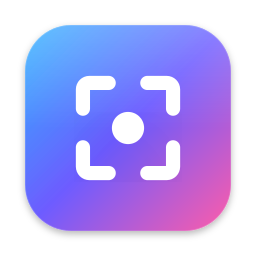

<p align="center">
  
</p>

# Glance

**Beautiful screenshots in two keystrokes.** Glance is a native macOS menu bar app that captures any area, window or screen, frames it on a polished background, lets you mark it up, and puts the result on your clipboard — ready to paste into Slack, docs or a tweet.

> Native Swift · ScreenCaptureKit · Retina-sharp output · 100% offline

---

## Highlights

- ⚡️ **Instant capture** — area, window or full screen from a global shortcut
- 🧊 **Frozen screen** — menus, tooltips and hover states stay put while you select
- 🔍 **Pixel-perfect selection** — magnifier loupe, crosshair and snapping to window edges
- 🎨 **Presentation-ready in one step** — gradient backgrounds, padding, rounded corners and a soft shadow
- ✏️ **Markup tools** — arrows, boxes, text, numbered steps and pixelation for sensitive data
- 📋 **Copy or save** — Retina-resolution PNG to the clipboard, Downloads or any folder you choose
- 🕘 **Recent captures** — reopen any of your last 10 screenshots, annotations included
- 🔒 **Private by design** — no accounts, no cloud, no network access

---

## Features

### Capture anything

**Area, window or full screen — one shortcut each.**

- **Area capture (⇧⌘1)** — drag to select any region, on any of your displays.
- **Window capture (⇧⌘1, then click)** — hover a window to highlight it, click to capture it. The window is captured *on its own*: even parts hidden behind other windows are included, corners stay transparent, and there's no desktop clutter behind it.
- **Full-screen capture (⇧⌘2)** — the whole display under your pointer, in one keystroke.
- **Multiple displays** — every display is frozen and selectable at once; the editor opens on the display you captured.
- **Works from anywhere** — it lives in the menu bar, with no Dock icon and no windows in your way.

### Selection that respects your pixels

**Frame exactly what you mean.**

- **Frozen screen** — the moment you press the shortcut, every screen is frozen. Open menus, tooltips and hover effects stay exactly as they were while you select, and end up in the capture.
- **Magnifier loupe** — a zoomed-in view of the pixels under your pointer (21×21 px at 6×), with the exact pixel outlined and its coordinates shown.
- **Crosshair guides** — full-screen guide lines through the pointer help you line things up.
- **Smart snapping** — selection edges snap to window and screen edges. Hold **⌥ Option** for free-hand precision.
- **Live size readout** — see the selection's dimensions as you drag.

### Make it presentation-ready

**From raw grab to polished image — automatically.**

- **Background presets** — 6 hand-picked gradients (Violet, Sky, Mint, Peach, Rose, Midnight), plain white, or transparent.
- **Adjustable padding** (0–160 pt) and **rounded corners** (0–32 pt).
- **Soft drop shadow** that makes the screenshot float above the background.
- **Remembers your style** — your background, padding, corners and colour carry over to the next screenshot. One click resets to defaults.
- **What you see is what you export** — the editor and the exported image are rendered by the same view, pixel for pixel.

### Mark it up

**Say what you mean, right on the screenshot.**

| Tool | Key | What it's for |
|---|---|---|
| ↗ Arrow | **A** | Point at things. Smooth, tapered arrows; hold **Shift** to snap to 45°. |
| ▭ Rectangle | **R** | Box an area. Hold **Shift** for a square. |
| **T** Text | **T** | Add a label. Click, type, press Enter. Double-click a label to edit it. |
| ① Counter | **N** | Number the steps in a flow — each click adds the next number. |
| ▦ Pixelate | **P** | Hide emails, names, tokens and other sensitive data. |

- **6 colours** — red, orange, yellow, green, blue, white.
- **Edit after drawing** — click any annotation to select it, drag to move (**Shift** locks the axis), **⌫** to delete, or pick a colour to recolour it.
- **Resize handles** — drag an arrow's ends, a box's corners and edges, or the corner of a label or number badge to scale it. **Shift** keeps 45° angles and squares.
- **Double-click to edit text** — fix a typo in place; clear the text to remove the label.
- **Full undo/redo** (⌘Z / ⇧⌘Z) for every change: adding, moving, resizing, editing, recolouring, deleting.
- **Real pixelation** — each block is the *average* of the pixels beneath it, so text becomes genuinely unreadable instead of flickering through.

### Zoom in on the details

- **Pinch to zoom**, two-finger scroll to pan — native trackpad gestures.
- **⌘+ / ⌘−** to zoom, **⌘0** to fit, **⌘1** for actual size (10%–800%).
- Large captures open fitted to the window; small ones at 100%.

### Share it

**Paste it anywhere in a second.**

- **Copy (⌘C)** — puts the finished image on the clipboard (PNG + TIFF, so it pastes into every app).
- **Save (⌘S)** — writes a PNG to Downloads or any folder you choose in Settings (Desktop included), named like macOS does (`Screenshot 2026-11-07 at 15.04.32.png`). Existing files are never overwritten.
- **Retina-sharp** — exports at the full resolution of your display, with correct DPI so images open at their on-screen size.
- **Transparent PNGs** — choose the "None" background to keep transparency, shadow included.

### Pick up where you left off

- **Recent Captures** — the menu bar keeps your last 10 screenshots with thumbnails. Pick one to reopen it with its annotations and style, exactly as you left it.
- **Nothing lost by closing** — closing an editor keeps your edits in Recent Captures; only *Discard* throws them away.
- **Memory only** — history is compressed in the background, never written to disk, and gone when you quit. **Clear History** empties it at any time.

### Fits into your Mac

- **Menu bar app** — out of sight until you need it.
- **Custom shortcuts** — record your own global shortcuts for each capture mode in Settings.
- **Open at login** — one toggle.
- **Floating editor** — stays above other windows; open several at once.
- **Forgiving** — Esc only deselects; closing an editor with annotations asks before discarding your work.

### Private and fast

- **No network access at all** — no accounts, no uploads, no analytics.
- **Native Swift** — built with ScreenCaptureKit, SwiftUI and AppKit. No Electron, no web views.
- **Light on resources** — no background processes besides the menu bar icon.

---

## Keyboard shortcuts

### Global

| Shortcut | Action |
|---|---|
| ⇧⌘1 | Capture area (click instead of dragging to capture a window) |
| ⇧⌘2 | Capture full screen |

Both can be changed in **Settings → Shortcuts**.

### While selecting

| Key | Action |
|---|---|
| Drag | Select an area |
| Click | Capture the highlighted window |
| ⌥ Option (hold) | Disable edge snapping |
| Esc | Cancel |

### In the editor

| Shortcut | Action |
|---|---|
| A · R · T · N · P | Arrow · Rectangle · Text · Counter · Pixelate |
| Shift (while drawing or resizing) | 45° arrows · square rectangles · axis-locked moves |
| Double-click text | Edit the label |
| ⌫ | Delete selected annotation |
| ⌘Z / ⇧⌘Z | Undo / Redo |
| ⌘C | Copy to clipboard and close |
| ⌘S | Save PNG and close |
| ⌘+ / ⌘− / ⌘0 / ⌘1 | Zoom in / out / fit / actual size |
| Esc | Deselect |
| ⌘W | Close editor |

---

## Requirements

- macOS 27.2 or later
- **Screen Recording** permission (asked for on first capture)
- Saving goes to **Downloads** out of the box; pick any other folder in **Settings → Export**

## Installation

### Build from source

1. Open `screenshot-app.xcodeproj` in Xcode 27 or later.
2. Select your development team under *Signing & Capabilities*.
3. **Product → Archive**, then **Distribute App → Custom → Copy App**.
4. Move the exported **Glance.app** to **/Applications** and open it.

> Run it from /Applications rather than straight from Xcode for daily use: macOS ties the Screen Recording permission and the "Open at login" item to the app's location and signature.

### First launch

1. Press **⇧⌘1**. macOS asks for Screen Recording access — allow **Glance** in **System Settings → Privacy & Security → Screen & System Audio Recording**.
2. Reopen Glance if macOS asks you to.
3. Optional: enable **Open at login** in Settings (Glance menu bar icon → Settings…).

## Privacy

Glance works entirely offline. Screenshots exist only in memory (including Recent Captures, which is cleared when you quit), on your clipboard, or in the folder you save them to. Nothing is collected, uploaded or shared. It runs in the macOS App Sandbox: the only access it has is Screen Recording (to capture), your Downloads folder, and the save folder you pick yourself.

---

## For developers

**Stack:** Swift 6 (strict concurrency), SwiftUI + AppKit, ScreenCaptureKit, Core Graphics, Carbon hot keys, `SMAppService`.

```
screenshot-app/
├── App/         Entry point, AppDelegate, shared @Observable state
├── MenuBar/     NSStatusItem and menu
├── Capture/     Capture modes and the coordinator that drives a capture
├── Selection/   Frozen-screen overlay: selection, window picking, loupe, snapping
├── Editor/      Editor window, canvas (zoom/pan), composition, annotations
├── Services/    Capture, render, export, permissions, hot keys, launch at login
└── Settings/    Settings window and shortcut recorder

GlanceTests/     XCTest unit tests (⌘U)
```

**Tests:** press **⌘U** in Xcode or run `xcodebuild test -scheme screenshot-app -destination 'platform=macOS'`. They cover annotation editing and resizing, undo, text editing, selection snapping and cropping, rendering and pixelation, hot keys, preferences and capture history. Tests run inside the app as their host, which skips the menu bar item and global hot keys, and use throwaway defaults suites, so they never touch your settings.

Design notes:

- **One view for screen and export** — `CompositionView` is shown in the editor and rendered by `ImageRenderer` for export, so output always matches the editor.
- **Annotations live in screenshot coordinates**, so they stay attached to content when padding changes.
- **Canvas input is handled in AppKit** (`CanvasInputView`), because SwiftUI gestures report wrong locations inside a magnified `NSScrollView`.
- **Global hot keys use Carbon `RegisterEventHotKey`**: no Accessibility permission needed, and the key press isn't leaked to the frontmost app.

### Releasing a DMG

`scripts/release-dmg.sh` archives the app, exports it signed with Developer ID, notarizes and staples both the app and the DMG, and checks the result with Gatekeeper. It prints the DMG path, SHA-256 and size for the download page.

It writes two identical files, `Glance-<version>.dmg` and `Glance.dmg`; attach both to the GitHub release. The unversioned one gives the landing page a download link that never changes: `https://github.com/glanceapphq/glanceapp/releases/latest/download/Glance.dmg`.

One-time setup: a **Developer ID Application** certificate in your keychain, and a stored notarization profile:

```sh
xcrun notarytool store-credentials glance-notary --apple-id <Apple ID> --team-id 59MJ8J2KF3
```

Bump **Version** / **Build** in the target settings before each release. `--skip-notarize` makes a quick local DMG that other Macs won't open.

## Roadmap

- [ ] Selections spanning more than one display
